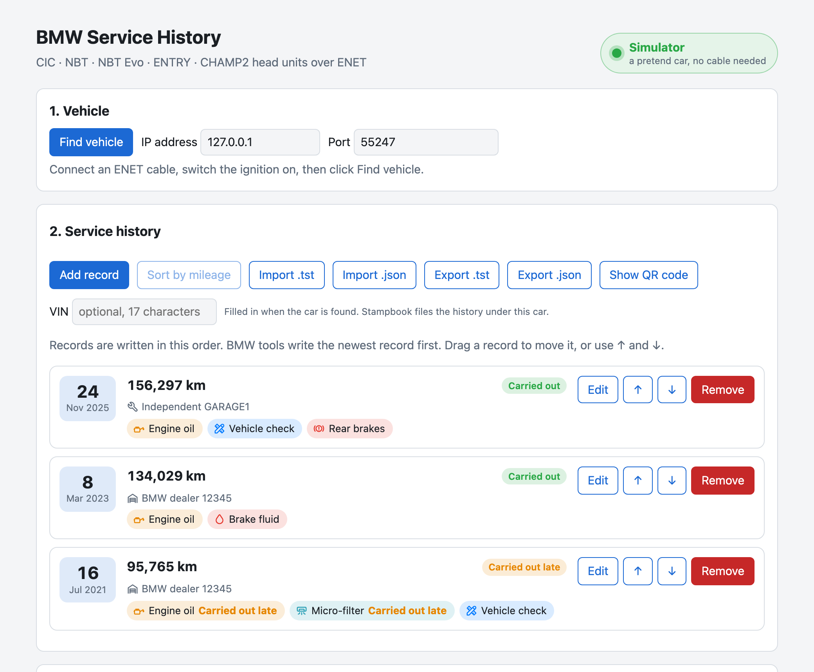

# BMW Service Manager

Write a BMW's service history into its head unit, so every service shows up on the car's own
**Service history** screen in iDrive. It also reads the **service due** (CBS) items the
instrument cluster shows, and resets them once the work is done.

It runs on a Mac, a Windows PC or Linux, in your web browser, and talks to the car through an
ENET cable. Nothing else needs installing: each download has everything it needs.



Works with BMW F, G and I-series cars with a CIC, NBT, NBT Evo, ENTRY or CHAMP2 head unit.
It was developed on an F48 X1 with NBT Evo; other cars should work but haven't all been tried.

## Download

| Your computer | Download |
| --- | --- |
| Mac (Apple silicon or Intel) | [BMW-Service-Manager-1.0.1-macOS.zip](https://github.com/devttys1/bmw-service-manager/releases/download/v1.0.1/BMW-Service-Manager-1.0.1-macOS.zip) |
| Windows 10 or 11 (64-bit) | [BMW-Service-Manager-1.0.1-Windows.zip](https://github.com/devttys1/bmw-service-manager/releases/download/v1.0.1/BMW-Service-Manager-1.0.1-Windows.zip) |
| Linux (64-bit Intel/AMD, or ARM such as a Raspberry Pi 4 or 5) | [BMW-Service-Manager-1.0.1-Linux.tar.gz](https://github.com/devttys1/bmw-service-manager/releases/download/v1.0.1/BMW-Service-Manager-1.0.1-Linux.tar.gz) |

This is version 1.0.1. All versions are on the [Releases](https://github.com/devttys1/bmw-service-manager/releases) page.

## Start it

Start it once at home first, so any questions your computer asks are out of the way before
you're at the car. You don't need the internet after installing.

### Mac

**Easiest: one line in Terminal.** This installs the app in Applications and opens it, with
no security warnings to get past.

1. Open **Terminal**: press ⌘-Space, type `Terminal`, press Return.
2. Copy this line, paste it into Terminal, and press Return:

   ```
   curl -fsSL https://github.com/devttys1/bmw-service-manager/releases/latest/download/install-mac.sh | bash
   ```

3. **BMW Service Manager** opens: a small window, and your web browser with the app in it.
   Turn on **Pretend car** in the window to look around without a car.

Next time, open **BMW Service Manager** from Applications (or Launchpad). Running the same
line again updates it to the newest version.

**Or download it.** Download the Mac zip above, open it, and drag **BMW Service Manager**
into Applications. The first time you open it, macOS says it can't check it for malicious
software, because it isn't from the App Store. Click **Done**, then open **System Settings >
Privacy & Security**, scroll down to the message about BMW Service Manager, click
**Open Anyway**, and enter your password if asked. You only do this once.

Keep the app's window open while you use it; quit the app (⌘Q) to stop. If macOS asks
whether BMW Service Manager may find devices on your local network, click **Allow**: that's
how it finds the car. It needs macOS 13 (Ventura) or later.

### Windows

1. Right-click the downloaded **BMW-Service-Manager-1.0.1-Windows.zip**, choose **Extract All...**,
   then **Extract**. Use the extracted **BMW Service Manager** folder, not the zip.
2. Double-click **Try without a car**.
3. The first time, Windows may say **Windows protected your PC**. Click **More info**, then
   **Run anyway**.
4. A black window opens, and your web browser shows BMW Service Manager with a pretend car.
   Leave the black window open while you use it. Close it to stop.

When you're at the car, double-click **Start BMW Service Manager** instead. If Windows
Firewall asks about python.exe, tick **Private networks** and click **Allow access**: that's
how it finds the car.

### Linux

1. Extract the download: right-click it and choose **Extract Here**, or in a terminal
   `tar xzf BMW-Service-Manager-1.0.1-Linux.tar.gz`.
2. Run **try-without-a-car.sh** in the **BMW Service Manager** folder (double-click it and
   choose **Run in Terminal**, or run it from a terminal).
3. Your web browser shows BMW Service Manager. If it doesn't open by itself, open the address
   the terminal shows. Press Ctrl+C in the terminal to stop.

At the car, run **start-bmw-service-manager.sh** instead.

## Connecting to the car

You need an **ENET cable** (Ethernet to the car's OBD port). If your computer has no Ethernet
port, add a USB Ethernet adapter.

1. Plug the ENET cable into the car's OBD port (in the driver's footwell) and into the computer.
2. Switch the ignition on. (The engine doesn't need to run, but keep the battery charged: use a
   charger for long sessions.)
3. Leave the computer's Ethernet set to obtain an address automatically (DHCP), which is the
   usual setting. The car gives itself an address starting with 169.254.
4. Start BMW Service Manager and click **Find vehicle**. The car's VIN appears, and the light at
   the top right turns green: **Connected**.

The light checks every few seconds:

- **Connected** (green): the car answers. Its VIN shows underneath.
- **Not responding** (red): check the cable, the adapter and that the ignition is on.
- **Not connected** (grey): no car chosen yet. Click **Find vehicle**, or type the address.

If **Find vehicle** finds nothing, a firewall may be blocking it. Type the car's address
(169.254.something) in **IP address** if you know it, or turn off Wi-Fi so the cable is the
only network.

## Using it

**Service history.** Click **Add record** for each service: date, mileage, dealer and the
items done (engine oil, brakes, vehicle check and so on, up to 13 per record). Dealers you've
typed before are offered again. **Sort by mileage** puts the highest mileage first, which is
how BMW's own tools write them. You can also drag records into order, or use the arrows.

**Writing to the car.** Under **Write to head unit**, click **Preview requests** to see exactly
what will be sent, then **Write to car** (click twice to confirm). With **Erase existing
history first** ticked, the car's current history is replaced.

**Service due (CBS).** Click **Read CBS** to see each item the instrument cluster tracks: how
much is left, and when it's due. **Reset** sets one item back to 100% after the service is done.
Hover over the **i** next to the heading for the details.

**Saving your work.** **Export .json** saves the history to a file; **Import .json** or
**Import .tst** loads one. The car's history can't be read back out, so back up your service
records on the head unit before writing: for example, photograph its Service history screen.

**To a phone or iPad.** **Show QR code** turns the history into a QR code that Stampbook (an
iPhone and iPad app) scans to copy it across. The code holds the records themselves, not a link.

**Light or dark.** Under **Advanced** at the bottom of the page, **Appearance** chooses Light,
Dark or System (follow the computer).

## Please be careful

- Writing service history and resetting service items changes your car's control units.
  Check what you're writing first.
- Erasing the head unit's history is permanent, and it can't be read back first. Back up your
  service records on the head unit before writing.
- Keep the ignition on and the battery charged while you work.

## Troubleshooting

**The browser didn't open.** On a Mac, click **Open in browser** in the app's window. On
Windows or Linux, open the address shown in the black window or terminal, usually
<http://127.0.0.1:8800/>.

**"It's already running."** Starting it twice just opens the one that's running. To stop it,
quit the app on a Mac, or close the black window or terminal.

**Write or CBS says it can't connect.** Look at the light at the top right. If it's red, check
the cable and ignition, then click **Find vehicle** again.

**Something else.** Open an issue on the
[Issues](https://github.com/devttys1/bmw-service-manager/issues) page, with what you did and
what the log at the bottom of the page says.

## For developers

It's a small Python web app (Flask) that speaks BMW's HSFZ diagnostic protocol over ENET.

```bash
python3 -m venv .venv
.venv/bin/pip install -e '.[dev]'
.venv/bin/python -m bmw_service_manager --simulate   # a pretend car; leave out --simulate for a real one
.venv/bin/python -m pytest                           # tests (tests/ui needs: pip install -e '.[ui]' && playwright install chromium)
```

`packaging/build.sh` makes the three downloads: it bundles a portable Python from
[python-build-standalone](https://github.com/astral-sh/python-build-standalone) with the app
and its packages (pinned in `packaging/requirements.txt`).

## License

Free for personal and other non-commercial use, under the
[PolyForm Noncommercial License 1.0.0](LICENSE.md). Commercial use, such as using it in a
paid service business or selling it, isn't allowed. The Python runtime and packages included
in the downloads keep their own licenses.

BMW, iDrive and ISTA are trademarks of BMW AG. This project isn't affiliated with, endorsed
by or sponsored by BMW AG.
